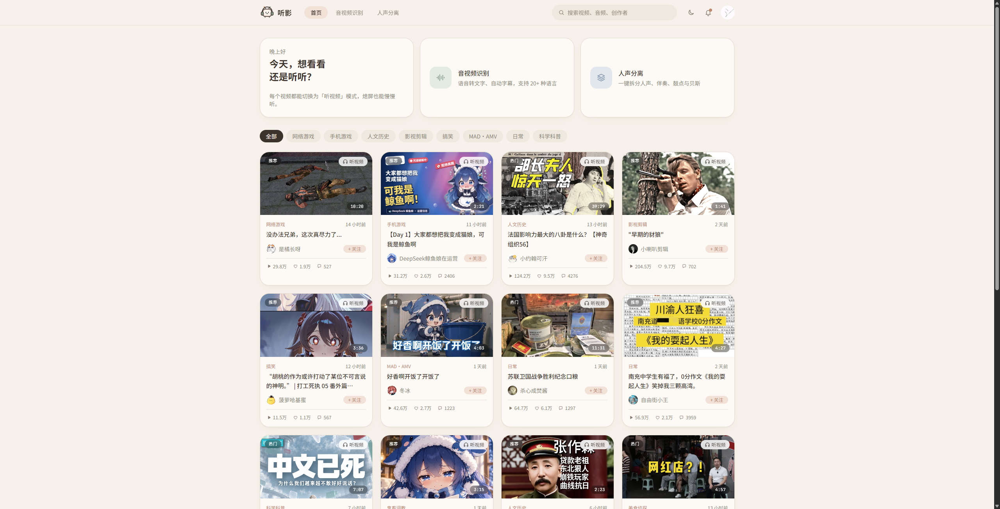
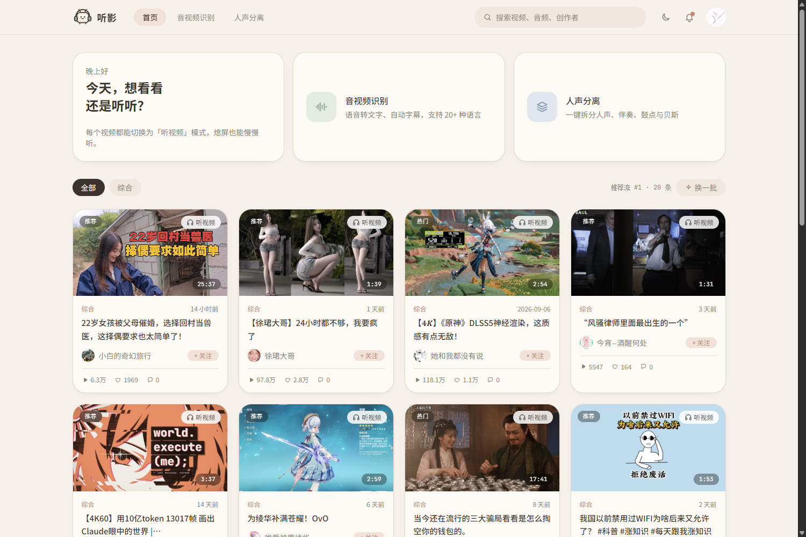
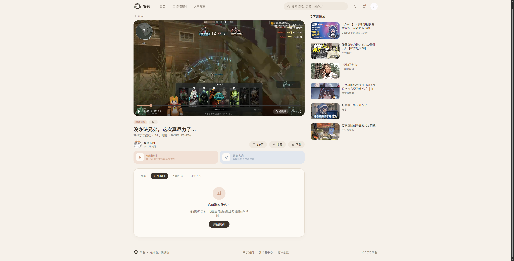
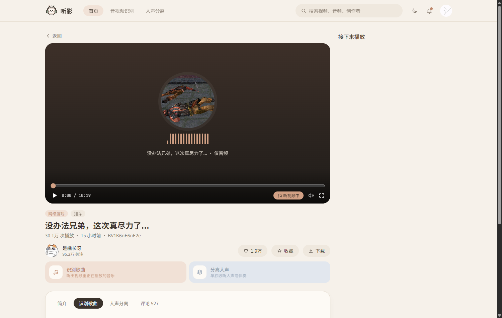
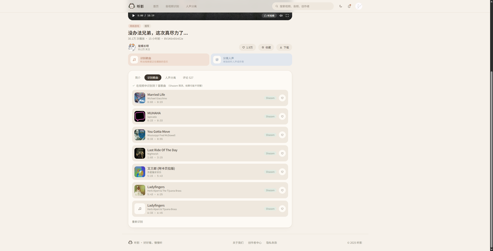
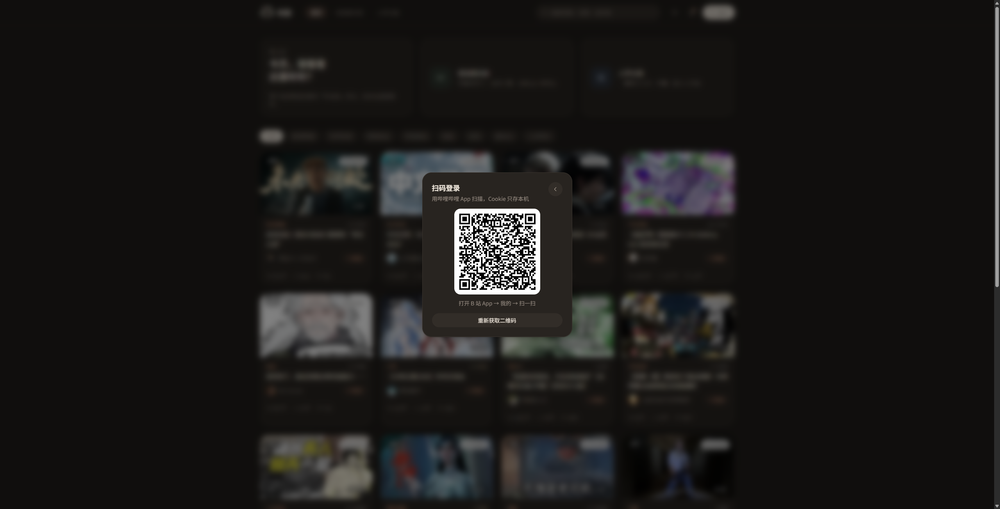
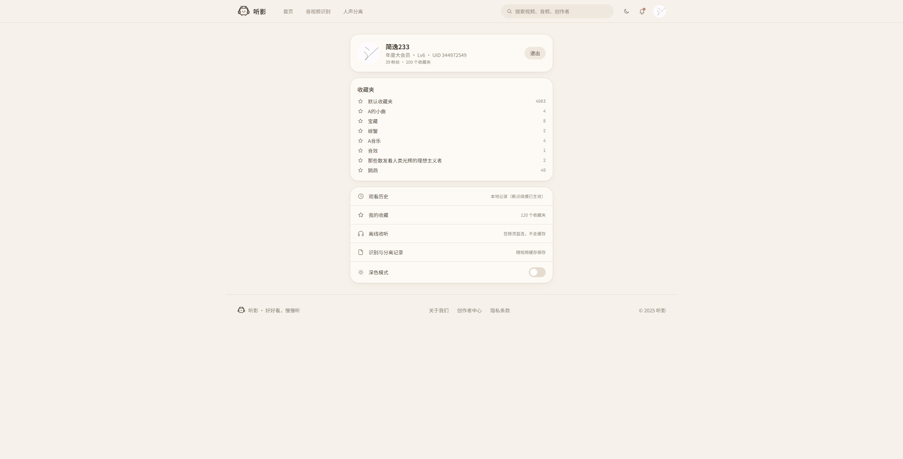

# 听影 · bilibili 本地播放器

> 一个**纯本地运行**的技术研究项目：逆向 bilibili 网页端的登录与内容接口（WBI 签名、扫码/短信登录、极验点选、播放地址、评论、收藏），
> 在本地拼出一个能真正播放、能听音频、能识别 BGM 的播放器界面。

**⚠️ 本项目仅供个人学习与技术研究使用，禁止任何形式的商业使用。**
**⚠️ 不提供、不托管、不分发任何音视频内容；所有内容仍来自 bilibili 官方服务器。**



---

## 这是什么

一个 Node 服务 + 三套前端界面，用来研究 bilibili 网页端接口是怎么工作的：

- **服务端（`login-demo/server.js`，约 1600 行）**：零框架 Node 服务，代持 Cookie、做 WBI 签名、代理二进制流、拉起 ffmpeg 合流
- **前端**：三套（Vue / React 暗色 / 听影），共用同一个后端，只是界面不同
- **不做的**：不破解 DRM、不绕过付费墙、不抓会员专属内容、不做爬虫、不建站对外提供服务

> 已登录账号仍是**普通用户权限**（Lv0/Lv6 普通账号）。4K / 杜比 / 1080P+ 等会员清晰度拿不到，
> 服务端会**自动降档**到能拿到的最高清晰度，不会尝试任何绕过。

---

## 界面截图

### 首页：真实热门列表 + 分页 + 换一批

热门榜是 bilibili 的一期快照，短时间刷新不变；所以额外接了推荐流「换一批」。



### 播放页：ffmpeg 合流 + 真实进度

音视频分轨（`.m4s`）在服务端用 ffmpeg 合流成完整 mp4 落盘，再按 Range 提供，所以能拖动进度、能看时长。
首次播放一个大文件要等合流，界面上有真实百分比和剩余时间。



### 听视频：只要声音，不看画面

切到纯音频流（`/api/audio/stream`），画面变成转盘 + 均衡器，适合通勤/熄屏听。



### BGM 识别：整片扫出曲目表

对整条音轨按 12s 窗口切段，走 Shazam 指纹识别（`shazamio`），合并相邻同曲，输出曲目时间轴。

实测《没办法兄弟，这次真尽力了…》识别结果：

| 时间 | 曲目 | 艺人 |
|---|---|---|
| 0:03 – 0:23 | Married Life | Michael Giacchino |
| 0:23 – 0:33 | MUHAHA | lapcada |
| 0:33 – 0:55 | You Gotta Move | Mississippi Fred McDowell |
| 1:03 – 3:15 | Last Ride Of The Day | Nightwish |
| 5:23 – 5:43 | 又三郎（阿卡贝拉版） | 外星猫牙乐 |
| 5:43 – 6:25 | Ladyfingers | Herb Alpert & The Tijuana Brass |

（Shazam 公开接口有限流，结果是"能识别到的部分"，不是完整曲库）



### 扫码登录

二维码走 `/x/passport-login/web/qrcode/generate`，轮询 `poll` 拿到 `Set-Cookie` 后落盘到本地 `session.json`（0600）。



### 我的

真实昵称 / 等级 / 大会员状态 / 粉丝数 / 收藏夹数量与列表。



---

## 功能清单

| 能力 | 状态 | 说明 |
|---|---|---|
| 扫码登录 | ✅ | `qrcode/generate` + `poll`，Cookie 只存本机 |
| 短信登录 + 极验点选 | ✅ | 极验面板镜像到本页面，坐标经 CDP 转发回真页面 |
| 搜索（关键词 / BV 号） | ✅ | WBI 签名 |
| 热门 / 排行榜 / 推荐流 | ✅ | 分页 + 「换一批」 |
| 收藏夹与收藏列表 | ✅ | 120 个收藏夹 / 4000+ 条 |
| 视频播放 | ✅ | dash 分轨 → ffmpeg 合流 → Range |
| 合流进度 | ✅ | `-progress pipe:1` 解析 + 平滑 ETA |
| 仅音频（听视频） | ✅ | 音频流直连 |
| 评论（只读） | ✅ | 分页、点赞数、IP 属地 |
| BGM 识别 / 全片曲目表 | ✅ | Shazam 指纹 |
| 人声分离 | ⚠️ | 代码完整，需 Replicate 额度（当前 402） |
| 下载 mp4 | ✅ | 合流后作为附件下载 |
| 断点续播 | ✅ | `localStorage` 记录位置（`/app` 与 `/ui` 实现不同） |
| 点赞 / 投币 / 收藏 / 关注 / 发评论 | ❌ | 需要 csrf 且会改真实账号数据，保持只读 |
| 弹幕渲染 / ASR 字幕 / 投稿 | ❌ | 未实现 |

---

## 快速开始

```bash
# 1) 后端（Node 22+，零依赖）
cd login-demo
node server.js                 # http://127.0.0.1:18787

# 2) 前端（任选一套）
#    /ui  听影（推荐，React 19 + Vite 8 + Tailwind 4）
cd login-demo/ui && npm install && npm run build
#    构建后直接访问 http://127.0.0.1:18787/ui/

#    /    旧 Vue 版（功能最全，含短信登录面板）
cd login-demo/web && npm install && npm run build

#    /app 暗色 React 版
cd login-demo/app && npm install && npm run build
```

需要的东西：

- **Node 22+**
- **ffmpeg / ffprobe**：放到 `login-demo/bin/`（已 gitignore，需自己下载）
- **Python 3.12 + shazamio**：只有 BGM 识别需要（`pip install shazamio`）
- 可选：Chrome + `--remote-debugging-port=9222`，只有短信登录的极验镜像需要

---

## 目录结构

```
.
├── doc/                     计划、设计、阻塞项、截图
├── changelog/               变更记录（Keep a Changelog）
├── login-demo/
│   ├── server.js            本地服务：代理 / Cookie / WBI / 静态 / 分析流水线
│   ├── lib/                 cdp.js（CDP 客户端）· sms.js（短信+极验状态机）· cloud.js（Replicate）
│   ├── py/recognize.py      Shazam 识别（shazamio）
│   ├── web/                 前端 A：Vue 3（/）
│   ├── app/                 前端 B：React 暗色（/app）
│   └── ui/                  前端 C：听影（/ui，当前主用）
└── tools/                   短信登录 CLI 辅助脚本
```

---

## 免责声明

**请在使用前完整阅读。使用本项目即表示你已知悉并接受以下全部内容。**

### 1. 用途与性质

1. 本项目是**个人技术学习与研究**的产物，用于理解现代 Web 应用的前端签名机制（WBI）、登录流程（OAuth 式扫码、短信 + 行为验证码）、媒体流组织方式（DASH 分轨 + 合流）。
2. 项目**不是** bilibili 的官方客户端、插件或衍生品，与上海幻电信息科技有限公司**没有任何关联**，也未获其授权、认可或支持。
3. 项目的**全部代码仅供阅读与本地学习**，不构成任何产品、服务或商业 offering。

### 2. 禁止商业使用

**严禁**将本项目（含代码、文档、衍生作品）用于任何商业目的，包括但不限于：

- 销售、出租、许可、订阅收费
- 集成进商业产品、SaaS、付费社群、培训课程
- 用于引流、广告变现、代下载/代解析等付费服务
- 企业内部生产环境部署

### 3. 内容与版权

1. 本项目**不存储、不托管、不分发任何音视频内容**。播放与下载的数据均实时来自 bilibili 官方 CDN。
2. 所有视频、音频、封面、用户头像、评论内容的**著作权归原作者及 bilibili 所有**。
3. 通过本项目获取的任何内容，**不得用于二次传播、转载、剪辑发布、二次创作或任何公开渠道分发**。
4. 请尊重创作者：喜欢的内容请通过官方渠道**点赞、投币、收藏、开通大会员**支持。

### 4. 账号与凭证

1. `session.json` 保存的是**你自己的**登录 Cookie，明文落盘在**本机**，权限设置为 0600。
2. 项目**没有任何服务端上传逻辑**：所有请求由本机 Node 进程直接发往 bilibili，不经过任何第三方服务器。
3. **请勿**把 `session.json`、抓包日志、Chrome 调试 profile 提交到 Git 或分享给他人（本仓库已通过 `.gitignore` 排除）。
4. 因凭证泄露导致的账号风险，由使用者自行承担。

### 5. 不做与不承诺

本项目**明确不做**以下事情，也不为其提供任何能力：

- ❌ 不破解 DRM / 不绕过付费墙 / 不获取会员专属清晰度
- ❌ 不绕过登录、不伪造身份、不盗用他人账号
- ❌ 不提供批量爬取、全站抓取、数据倒卖的能力
- ❌ 不搭建对公网开放的解析站点
- ❌ 不规避风控、不伪造设备指纹用于规模化请求

遇会员清晰度（4K / 杜比 / 1080P+）时，服务端会**自动降档**，不会尝试任何绕过手段。

### 6. 使用风险

1. 频繁请求可能触发 bilibili 的风控与限流（如 Shazam 也会限流），可能导致**临时封禁、验证码加严、账号异常**。
2. **使用本项目产生的任何后果（账号受限、数据丢失、设备异常、法律纠纷）由使用者自行承担**，作者不承担任何直接或间接责任。
3. 请自行控制请求频率，不要用于压力测试或规模化采集。

### 7. 条款与合规

1. 使用本项目前，请自行阅读并遵守 [bilibili 用户协议](https://www.bilibili.com/protocol/tos.html)、[隐私政策](https://www.bilibili.com/blackboard/privacy-pc.html) 及相关法律法规。
2. 若你的使用场景与上述条款冲突，请**立即停止使用并删除本项目**。
3. 本项目不提供任何法律意见。

### 8. 权利与删除

1. "bilibili"、"哔哩哔哩"、小电视形象等标识为权利人商标，本项目仅作**描述性提及**，不主张任何权利。
2. 若权利人认为本项目内容不当，请通过仓库 Issue 联系，作者将**在第一时间删除相关内容或整个仓库**。

### 9. 无担保

本项目按 **"AS IS"** 提供，不附带任何明示或暗示的担保，包括但不限于适销性、特定用途适用性与非侵权担保。接口随时可能变更，项目随时可能失效。

### 10. 生效

**当你克隆、下载、运行或以任何方式使用本项目时，即视为你已阅读、理解并同意上述全部条款。如果你不同意，请立即删除本项目。**

---

## 变更记录

见 [`changelog/CHANGELOG.md`](changelog/CHANGELOG.md) 与 [`doc/ROADMAP.md`](doc/ROADMAP.md)（计划）、[`doc/BLOCKERS.md`](doc/BLOCKERS.md)（已知限制）。

## 致谢

- [bilibili](https://www.bilibili.com/)：接口与内容
- [shazamio](https://github.com/shazamio/ShazamIO)：Shazam 指纹识别
- [FFmpeg](https://ffmpeg.org/)：音视频合流
- [puppeteer-core](https://pptr.dev/) 思路的 CDP 直连（本项目只用了原生 WebSocket）
